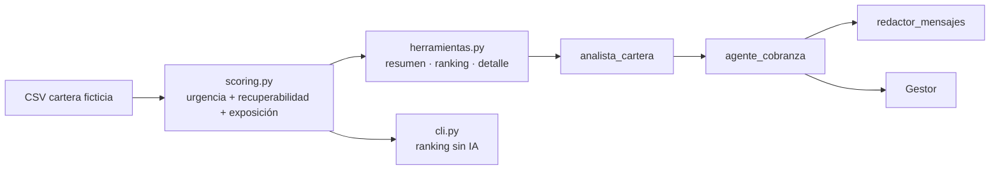

# Agente priorizador de cartera morosa

Asistente para gestores del área de **Recuperaciones (cobranza)** de una caja municipal. Responde tres preguntas del día a día del gestor:

1. **¿A quién contacto primero?** Ranking de créditos por prioridad, con los motivos de cada posición.
2. **¿Qué le ofrezco?** Acción sugerida según el tramo de mora y la probabilidad de pago.
3. **¿Cómo se lo digo?** Mensaje de WhatsApp/SMS o guion de llamada, cordial y respetuoso.

Combina un **puntaje determinista y explicable** (Python puro, sin IA) con **agentes de IA** construidos con Google Agent Development Kit (ADK) y **Gemini**.

> ⚠️ Todos los datos son **ficticios**, generados con `data/generar_cartera.py`. No se usan datos reales de clientes ni de ninguna entidad financiera.

## Arquitectura

```text
Gestor → ADK (consola o web)
           ↓
   agente_cobranza (coordinador, Gemini)
     ├── analista_cartera  → herramientas Python → puntaje determinista sobre el CSV
     └── redactor_mensajes → mensaje o guion según tramo y canal
```



**¿Por qué el puntaje no lo calcula la IA?** Porque en una entidad financiera cada decisión tiene que ser reproducible y auditable. El modelo de IA nunca inventa números: solo consulta las herramientas y explica sus resultados.

## Cómo se calcula la prioridad

Prioridad (0 a 100) = **35% urgencia + 35% recuperabilidad + 30% exposición**

| Componente | Qué mide | Cómo |
|---|---|---|
| Urgencia | Riesgo de que el crédito salte al siguiente tramo de mora | 100 si faltan 5 días o menos para cambiar de tramo; baja a medida que falta más |
| Recuperabilidad | Probabilidad estimada de pago | Pagos puntuales en 12 meses (+), promesas incumplidas (−), días de atraso (−), garantía (+) |
| Exposición | Dinero en riesgo | Saldo de capital en escala logarítmica respecto del mayor saldo de la cartera |

Si el cliente fue contactado hace menos de 3 días, la prioridad baja un 40% para no insistir de más.

**Tramos de mora:** preventiva (0 días) · temprana (1–30) · intermedia (31–60) · tardía (61–120) · prejudicial (más de 120).

**Acciones por tramo:** recordatorio amable → recordatorio con fecha de compromiso o llamada para entender la causa → reprogramación o visita de negociación → visita y refinanciamiento (o información sobre la garantía) → evaluación de cobranza prejudicial.

Los pesos y umbrales son una propuesta inicial pensada para calibrarse con datos históricos reales de recuperación.

## Requisitos

- Python 3.10 o superior.
- Una llave gratuita de la API de Gemini (Google AI Studio). Solo hace falta para el agente; el ranking en consola funciona sin llave.

## Instalación

```bash
git clone https://github.com/Jh0sting/agente-priorizador-cobranza.git
cd agente-priorizador-cobranza

python3 -m venv .venv
source .venv/bin/activate
pip install -r requirements.txt
```

## Configuración segura

```bash
cp .env.example .env
```

Edita `.env` y coloca tu llave de [Google AI Studio](https://aistudio.google.com/apikey):

```env
GOOGLE_API_KEY=TU_LLAVE
GOOGLE_GENAI_USE_VERTEXAI=FALSE
GEMINI_MODEL=gemini-2.5-flash
```

`.env` está excluido de Git. `GEMINI_MODEL` es opcional.

## Uso

### 1. Ranking en consola (sin IA)

```bash
python cli.py --resumen                       # panorama por tramo
python cli.py --top 10                        # a quién contactar primero
python cli.py --tramo temprana --top 5
python cli.py --distrito "La Esperanza"
```

Ejemplo de salida:

```text
 #  Crédito   Cliente                      Tramo       Días  Saldo (S/) Prior.  Acción sugerida
 1  CR-00173  Luis Díaz Huamán             temprana      29    8,169.86   87.3  Recordatorio de pago y registrar fecha de compromiso (Llamada)
               · En 2 día(s) pasa del tramo temprana al siguiente
               · Buen historial: 11 de 12 cuotas puntuales
               · Cuenta con garantía
```

### 2. Agente de IA

```bash
adk web      # interfaz de desarrollo en http://localhost:8000, elige "agente_cobranza"
adk run agente_cobranza   # en consola
```

Preguntas de ejemplo:

- «¿A qué 5 clientes debo llamar hoy y por qué?»
- «¿Cómo está la cartera por tramo de mora?»
- «Dame los créditos de mora intermedia en El Porvenir.»
- «Redacta el mensaje de WhatsApp para el crédito CR-00139.»
- «Prepárame el guion de llamada para CR-00024.»

### 3. Regenerar los datos ficticios

```bash
python data/generar_cartera.py --n 500 --semilla 7
```

## Pruebas

```bash
python -m unittest discover -s tests
```

## Estructura del proyecto

```text
cobranza/
  scoring.py        # Puntaje de prioridad, tramos y acciones (sin IA)
  herramientas.py   # Funciones que usa el agente: resumen, ranking, detalle
agente_cobranza/
  agent.py          # Agentes ADK con Gemini
data/
  generar_cartera.py   # Generador de cartera ficticia
  cartera_ficticia.csv # 200 créditos ficticios
cli.py              # Ranking en consola
tests/              # Pruebas unitarias del puntaje
```

## Cobranza responsable

El redactor de mensajes tiene reglas explícitas: tono cordial, sin amenazas ni presión, sin mencionar la deuda a terceros y ofreciendo siempre una salida (fecha de compromiso, reprogramación o visita a la agencia). El puntaje es una ayuda para el gestor, no una decisión automática sobre el cliente.

## Próximos pasos

- Calibrar pesos con datos históricos de recuperación (o reemplazar la recuperabilidad por un modelo entrenado).
- Enviar los recordatorios automáticamente por WhatsApp o Telegram con n8n y registrar las promesas de pago.
- Panel web para que el jefe de Recuperaciones vea el avance de cada gestor.
